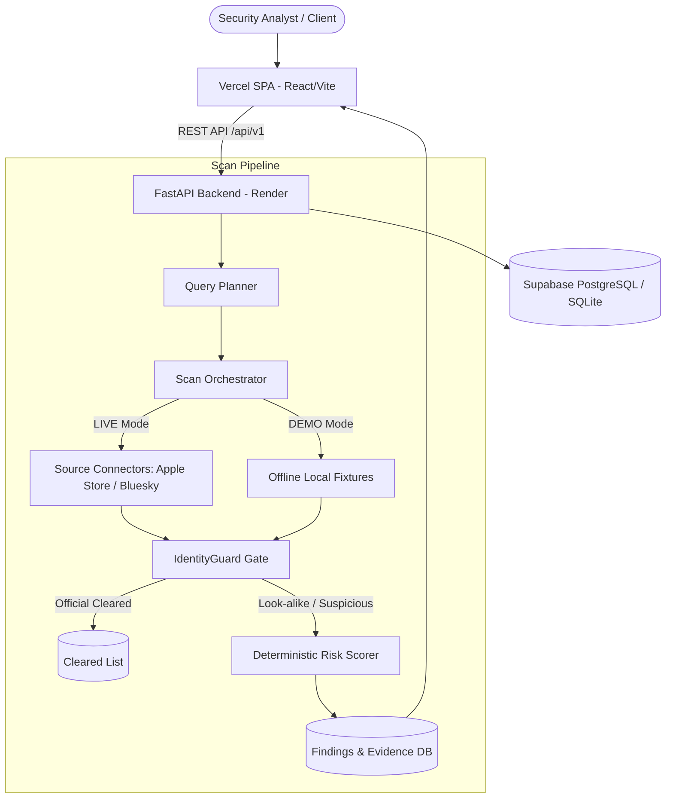

# ThreatLens v3 — Digital Risk Protection & Brand Defense Platform

[](docs/ARCHITECTURE_API_CONTRACT.md)
[](pyproject.toml)
[](backend/requirements.txt)
[](pyproject.toml)
[](#license)

**ThreatLens** is an enterprise-grade Digital Risk Protection (DRP) and Brand Defense platform built to monitor, detect, and triage unauthorized brand impersonation, deceptive look-alike accounts, and malicious application assets across public social networks (Bluesky, decentralized platforms) and official mobile app stores (Apple App Store, Google Play).

Built upon a strict **Contract-First Architecture** governed by [docs/ARCHITECTURE_API_CONTRACT.md](docs/ARCHITECTURE_API_CONTRACT.md), ThreatLens guarantees rigorous mathematical funnel accounting, airtight separation between offline simulated demo fixtures and live API scans, deterministic brand identity clearance (IdentityGuard), and audit-trailed analyst triage decisions.

---

## 📌 Repository Description & Metadata

If you are setting up or updating your GitHub repository details on [RaghuRam994940/ThreatLens-v1](https://github.com/RaghuRam994940/ThreatLens-v1):

- **Repository Name:** `ThreatLens-v1`
- **Short Description / Tagline:**
  > *Enterprise-grade Digital Risk Protection (DRP) & Brand Defense platform detecting brand impersonation, look-alike apps, and social spoofing with deterministic verification.*
- **Topics / Tags:**
  `digital-risk-protection`, `brand-defense`, `cybersecurity`, `threat-intelligence`, `fastapi`, `anti-phishing`, `python`, `react`, `app-store-monitoring`

---

## 🚀 Key Architectural Guarantees

1. **Candidates for Review, Not Instant Accusations:**
   The platform surfaces *candidates for review* with concrete evidence dossiers. Only authorized security analysts can transition candidates to `CONFIRMED_SUSPICIOUS` or `TAKEDOWN_REQUESTED`.
2. **Exact Identity Clearance (IdentityGuard):**
   Official assets are verified and cleared strictly by verifiable cryptographic IDs (DIDs, bundle IDs, verified developer credentials) rather than loose name similarities.
3. **Strict Network & Mode Isolation:**
   - **`DEMO` Mode:** Operates exclusively using offline local fixture bundles with 0 outgoing network or socket calls.
   - **`LIVE` Mode:** Enforces live external provider calls with rate limiters and error recovery, strictly disallowing simulated fixtures.
4. **Mathematical Result-Funnel Conservation:**
   Every scan accounts for all planned queries, executed requests, raw candidates, and evaluated items:
   $$\text{analyzed\_candidates} = \text{official\_cleared} + \text{not\_relevant} + \text{benign\_lookalike} + \text{below\_threshold} + \text{findings}$$
5. **Deterministic Scoring & Full Auditability:**
   Risk scores are calculated via rule gates and weighted feature signals rather than unexplainable probabilistic models. Every analyst action generates an immutable audit log.

---

## 🏗️ Architecture & Pipeline Flow



---

## 📂 Repository Directory Layout

```text
ThreatLens/
├── .env.example                     # Environment variable blueprint
├── .gitignore                       # Git ignore specifications
├── pyproject.toml                   # Project tool configuration (Ruff & Pytest)
├── render.yaml                      # Render Blueprint specification
├── vercel.json                      # Vercel SPA proxy & deployment config
├── docs/
│   ├── ARCHITECTURE_API_CONTRACT.md # Frozen Contract v3.0.0
│   ├── DEPLOY.md                    # Multi-cloud deployment guide
│   └── openapi.snapshot.json        # Contract OpenAPI schema snapshot
├── frontend/                        # React / Vite / Tailwind UI dashboard
└── backend/
    ├── requirements.txt             # Pinned backend dependencies
    ├── app/
    │   ├── main.py                  # FastAPI lifespan & entry point
    │   ├── api/routes/              # API endpoints (brands, assets, scans, findings, sources)
    │   ├── core/                    # Security, rate-limiting, error envelope, memory store
    │   ├── repositories/            # Data access layer protocols
    │   ├── schemas/                 # Strict Pydantic v2 contract schemas
    │   └── services/
    │       ├── orchestration.py     # Scan orchestrator and dispatch engine
    │       ├── identity_guard/      # Official brand asset identity verification
    │       ├── query_planner/       # Multi-source search query formulation
    │       └── sources/             # Live and fixture connector adapters
    └── tests/                       # Unit, contract, and end-to-end test suites
```

---

## 📡 REST API Overview

All API routes are served under prefix `/api/v1`. Interactive OpenAPI documentation is accessible at `/docs` (Swagger UI) and `/redoc` (ReDoc).

| Category | Endpoint | Method | Description |
| :--- | :--- | :--- | :--- |
| **System** | `/health`, `/ready`, `/meta` | `GET` | Health checks, readiness probes, and runtime service metadata |
| **Brands** | `/brands` | `GET` / `POST` | List and register monitored corporate brands |
| **Brands** | `/brands/{id}/summary` | `GET` | Aggregated threat score, active findings, and scan history |
| **Brands** | `/brands/{id}/cleared` | `GET` | Verified official assets and dismissed entities |
| **Brands** | `/brands/{id}/audit` | `GET` | Immutable chronological log of brand actions |
| **Assets** | `/brands/{id}/assets` | `GET` / `POST` | Official registered brand digital assets |
| **Assets** | `/brands/{id}/assets/prefill`| `POST` | Safe auto-discovery of asset metadata from official URLs (SSRF protected) |
| **Scans** | `/brands/{id}/scans` | `GET` / `POST` | Trigger and list brand scan executions (`LIVE` or `DEMO`) |
| **Scans** | `/scans/{scan_id}` | `GET` | Real-time scan progress, stage breakdown, and funnel metrics |
| **Sources**| `/sources/status` | `GET` | Active connector coverage catalog and adapter health |
| **Findings**| `/findings` | `GET` | Query and filter detected threat candidates |
| **Findings**| `/findings/{id}/decision` | `PATCH` | Analyst triage (`CONFIRMED`, `DISMISSED`, `TAKEDOWN_REQUESTED`) |
| **Findings**| `/findings/{id}/comparison`| `GET` | Side-by-side candidate vs. official asset breakdown (diff & icon hash) |
| **Findings**| `/findings/{id}/evidence` | `GET` | Raw exportable evidence package for registrar takedown requests |

---

## 🛠️ Local Development & Quickstart

### 1. Prerequisites
- **Python:** 3.10 or 3.12+
- **Node.js:** 18+ (for frontend dashboard)
- **Git**

### 2. Clone the Repository
```bash
git clone https://github.com/RaghuRam994940/ThreatLens-v1.git
cd ThreatLens-v1
```

### 3. Backend Setup
```bash
# Create and activate virtual environment
# Windows (PowerShell):
python -m venv venv
.\venv\Scripts\Activate.ps1

# Linux / macOS:
python3 -m venv venv
source venv/bin/activate

# Install dependencies
pip install -r backend/requirements.txt

# Configure environment variables
cp .env.example backend/.env
```

### 4. Run Backend Server
```bash
python -m uvicorn app.main:app --app-dir backend --host 127.0.0.1 --port 8000 --reload
```
- API Base: `http://127.0.0.1:8000/api/v1`
- Swagger UI: `http://127.0.0.1:8000/docs`
- Health Probe: `http://127.0.0.1:8000/api/v1/health`

### 5. Frontend Setup (Optional)
```bash
cd frontend
npm install
npm run dev
```

---

## 🧪 Testing & Code Quality

ThreatLens enforces test parity and strict formatting:

```bash
# Run Ruff lint check
python -m ruff check .

# Run all test suites
python -m pytest -v

# Run OpenAPI contract snapshot parity test
python -m pytest -v backend/tests/test_openapi_matches_contract.py

# Run network isolation tests (DEMO vs LIVE)
python -m pytest -v backend/tests/test_api_scans.py -k "demo or live"
```

---

## ☁️ Deployment

- **Backend:** Ready for deployment on [Render](https://render.com) using [`render.yaml`](render.yaml) or Docker.
- **Frontend:** Ready for deployment on [Vercel](https://vercel.com) using [`vercel.json`](vercel.json).
- **Database:** Compatible with Supabase Managed PostgreSQL or internal SQLite.
- Full deployment instructions available in [docs/DEPLOY.md](docs/DEPLOY.md).

---

## 📄 License & Standards

All contributions must conform to the frozen architecture contract in [docs/ARCHITECTURE_API_CONTRACT.md](docs/ARCHITECTURE_API_CONTRACT.md).
